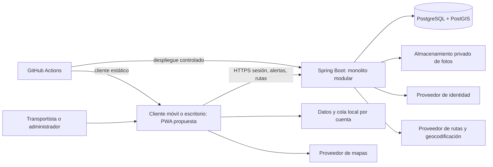
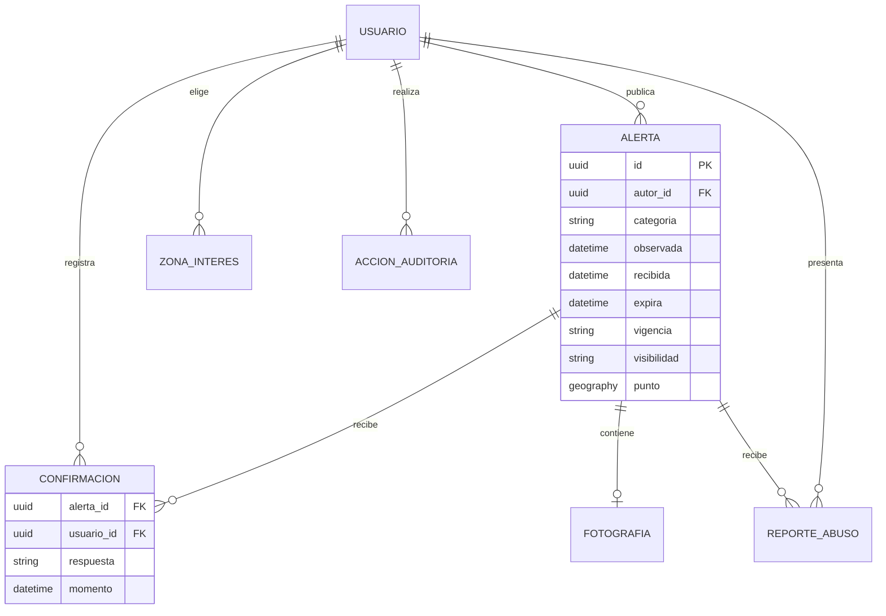

# TransporMap — Stack y arquitectura propuestos

**Fase 3: dirección aprobada por JhanDev, con condiciones de viabilidad pendientes.** El propietario aclaró que el despliegue será una **demo pública de portafolio**, no un servicio vial operacional de producción; las alertas y fotos siguen requiriendo sesión. Consulta de condiciones: 18 de noviembre de 2026. Fuente de verdad: [requisitos aprobados](01-requisitos.md). Esta arquitectura evoluciona el TransporMap legado descrito en [reconocimiento](00-informe-reconocimiento.md): conserva sus conceptos, pantallas y campos útiles; reconstruye los componentes y el esquema que no pueden trasladarse directamente. No hay datos Oracle que migrar. No se han creado cuentas, desplegado servicios, probado proveedores ni escrito código de producción.

## 1. Recomendación y límites

La dirección aprobada contempla un **monolito modular Spring Boot**, un cliente **React + TypeScript como PWA adaptable**, PostgreSQL con **PostGIS**, almacenamiento privado de fotos y proveedores externos reemplazables para mapa/ruta. La aplicación seguiría siendo TransporMap y sus dominios usuario, denuncia/alerta, lugar, tramo, carretera y evento se trazan en el modelo. La PWA es una web que puede instalarse, no una app Android nativa; su viabilidad queda sujeta a las pruebas acordadas.

**Combinación candidata para una demostración**, no despliegue garantizado: Render Free para Spring Boot, Supabase Free para Postgres/PostGIS, identidad y archivos privados, Cloudflare Pages para el cliente, Geoapify para mapa y ruta, GitHub Actions para CI/CD. Alertas en cliente abierto mediante consultas de cambios periódicas; push cerrado queda condicionado. Alternativas, condiciones y puntos que pueden invalidar la combinación se detallan abajo.

**Bloqueo de validación, no solución demostrada:** los planes gratuitos seleccionados no acreditan por sí mismos RPO ≤24 h, RTO ≤4 h y retención de respaldo de 30 días para datos y fotos; Render dice que su cómputo Free no es para producción y puede cobrar excedentes de transferencia; requiere comprobar controles de gasto y alta sin tarjeta. Supabase Free no incluye respaldos automáticos y puede pausar el proyecto. Hasta verificar cuentas, condiciones, backups y pruebas no se puede afirmar que el conjunto cumpla COP 0 ni disponibilidad de un servicio de carretera. No se autoriza compra, tarjeta o cambios de requisitos por aprobar este documento.

Los criterios usados en cada comparación: ajuste a sesión/privacidad y uso en carretera; condiciones y límites gratuitos publicados; experiencia de JhanDev; madurez documental/ecosistema; coste de aprendizaje y mantenimiento por una persona; potencial para mostrar trabajo a reclutadores. «Empleabilidad» es valoración cualitativa sin estadísticas de vacantes; no se afirma que una opción gane por cuota de mercado. Volúmenes indicados son cuotas, no rendimiento probado.

## 2. Comparación por capa

### 2.1 Plataforma móvil y frontend

| Criterio | Web adaptable instalable/PWA | App multiplataforma: Flutter o React Native |
|---|---|---|
| Distribución | Enlace accesible móvil/escritorio, instalación donde esté soportada; evita cuota de tienda. | Paquetes y prueba por plataforma; puede requerir cliente web administrativo adicional. Android permite distribución distinta de Play, pero no se presupone ausencia de requisitos o fricciones. |
| Offline | Datos/fotos locales posibles; el navegador puede desalojarlos o negar persistencia; Background Sync no está disponible universalmente. Reintentar al abrir. | Almacenamiento local y trabajos del sistema también requieren cola, control de recursos y pruebas; el sistema puede diferirlos. |
| GPS/avisos | GPS en HTTPS con permiso. Push cerrado depende de plataforma/permiso; WebKit exige añadir la web a inicio en iOS compatible. | Acceso a APIs nativas; permisos y políticas de segundo plano siguen limitando entrega. |
| Costo y esfuerzo | No requiere cuenta de tienda; hosting sigue sujeto a cuota. Una base de cliente para móvil/escritorio. | Google Play cobra USD 25 una vez; Apple Developer Program USD 99/año para distribución de programa; otras modalidades deben evaluarse. Más herramientas y pruebas. |
| Perfil y aprendizaje | Encaja con su experiencia React y portafolio accesible por enlace. | React Native aprovecha parte de React; Flutter requiere Dart. Mejor demostración de móvil nativo, con mayor complejidad para este objetivo. |

Recomendación **PWA React/TypeScript**, condicionada a prueba en Tecno Android 14: persistencia tras cierre, cámara, fotos protegidas, autorización offline de 7 días, sincronización y restricciones de segundo plano. No se ha probado iOS. Un fallo de prueba obliga a replantear arquitectura y regresar al propietario, no a eliminar requisitos en silencio. Fuentes: [MDN Background Sync](https://developer.mozilla.org/en-US/docs/Web/API/Background_Synchronization_API), [almacenamiento y desalojo](https://developer.mozilla.org/en-US/docs/Web/API/Storage_API/Storage_quotas_and_eviction_criteria), [geolocalización](https://developer.mozilla.org/en-US/docs/Web/API/Geolocation_API), [Web Push iOS](https://webkit.org/blog/13878/web-push-for-web-apps-on-ios-and-ipados/), [registro Google Play](https://support.google.com/googleplay/android-developer/answer/6112435?hl=en-GB), [Apple Developer](https://developer.apple.com/programs/whats-included).

**Framework web: React + TypeScript frente a Vue + TypeScript.** Ambos permiten interfaz completa, biblioteca de mapas y cliente desacoplado; Vue implica aprender un ecosistema adicional, mientras React aprovecha experiencia declarada y deja más tiempo para Spring. Ninguno implementa offline por instalarlo. React favorece portafolio por experiencia demostrable, no por datos de empleo cuantificados. Propuesta: React con compilación estática y librerías mínimas; no introducir SSR sin requisito. [React](https://react.dev/learn/creating-a-react-app), [Vue](https://vuejs.org/guide/introduction). Flutter web también existe, pero su mantenimiento offline tiene particularidades; [documentación Flutter](https://docs.flutter.dev/platform-integration/web/faq).

### 2.2 Backend, estructura y compilación

| Alternativa | Ajuste, coste y mantenimiento |
|---|---|
| **Spring Boot monolito modular** | Un ejecutable con módulos explícitos, un despliegue y transacciones coherentes. Reutiliza conocimiento y premisa Java; facilita mostrar dominio Spring. Un fallo afecta al conjunto y debe vigilarse el arranque y memoria en planes gratuitos. |
| **Spring Boot microservicios** | Aislamiento por despliegue y escalado, pero suma red, observabilidad, consistencia, mantenimiento y hosting; no hay volumen demostrado que lo justifique. |

Se propone monolito modular con dependencias orientadas al dominio. [Spring Boot: requisitos de sistema](https://docs.spring.io/spring-boot/system-requirements.html) documenta versiones estables y Java mínimo; verificar rama soportada y compatibilidad cuando se apruebe el plan. **Java 21 LTS o 25 LTS** deben compararse frente a imágenes y proveedor elegidos; no se fija parche sin esa comprobación. No continuar Java 19 solo porque el legado lo usaba.

**Maven vs Gradle:** ambos compilan y prueban Java, permiten reproducibilidad con wrapper y dependen de descarga de artefactos. Maven ofrece ciclo estándar y configuración declarativa familiar; Gradle ofrece flexibilidad y caché, con más opciones de scripting. Propongo Maven por uniformidad y simplicidad para un mantenedor; Gradle es alternativa válida. Documentación: [Maven](https://maven.apache.org/guides/getting-started/), [Gradle](https://docs.gradle.org/current/userguide/userguide.html).

### 2.3 Persistencia geográfica y proveedores de BD

**PostgreSQL + PostGIS frente a MySQL con funciones espaciales:** ambos soportan datos geográficos; PostGIS ofrece operaciones e índices documentados para distancias de punto/línea y consultas en metros con `geography`. MySQL puede cumplir búsquedas espaciales, pero debe validarse con mayor cuidado la distancia a una ruta, sistema de coordenadas y capacidades del proveedor; JhanDev conoce MySQL. Se propone PostgreSQL/PostGIS por ajuste a 1 km alrededor de una ruta y 20 km alrededor de un punto, no porque MySQL sea incapaz. [PostGIS ST_DWithin](https://postgis.net/docs/ST_DWithin.html), [MySQL análisis espacial](https://dev.mysql.com/doc/refman/8.4/en/spatial-analysis-functions.html).

| Servicio | Free y límites publicados | Coste operativo / ajuste |
|---|---|---|
| **Supabase** | 500 MB BD/proyecto, 1 GB de archivos y 5 GB egress + 5 GB egress cacheado; 50.000 usuarios activos mensuales; hasta dos proyectos activos; pausa tras una semana sin actividad; sin backups automáticos Free. [Precios](https://supabase.com/pricing). | PostGIS, Auth y almacenamiento disponibles en un proveedor; simplifica integraciones, pero concentra fallo y depende de cuotas y pausas. Confirmar condiciones de alta y exportación/restauración. |
| **Neon** | Sin tarjeta, 1 GB/proyecto, 100 CU-h/mes/proyecto, 5 GB transferencia; se suspende al agotar cómputo o red; escritura que incremente almacenamiento falla al superar límite. Restauración instantánea Free limitada a 6 h o 1 GB de cambios. [Precios](https://neon.com/pricing). | PostgreSQL gestionado con escala a cero; comprobar versión/extensión PostGIS antes de usar. A 0,25 CU continuo durante 730 h serían ~182,5 CU-h, más de la cuota: sondeo o cron que impidan suspensión pueden agotar el plan. |

Recomiendo **Supabase Postgres/PostGIS como candidata integrada**, sin usar su API como sustituto de Spring. Neon es alternativa con mayor almacenamiento pero cuota de cómputo y respaldo distintos. Ninguno acredita respaldo diario por 30 días; una instantánea del proveedor no sustituye exportación restaurable de BD **y fotos**.

### 2.4 Mapas, geocodificación y rutas

| Alternativa | Ajuste y límites |
|---|---|
| **Geoapify** | Free sin tarjeta: 3.000 créditos/día compartidos, 5 solicitudes/s; tesela 0,25 crédito según [detalle de precios](https://www.geoapify.com/pricing-details/), ruta simple desde 1 crédito por tramo y recargos según consulta. 3.000 créditos no son a la vez 12.000 teselas y 3.000 rutas. [Precios](https://www.geoapify.com/pricing/), [Routing](https://apidocs.geoapify.com/docs/routing/). |
| **MapTiler + openrouteservice** | Proveedores separados y más piezas; MapTiler ofrece plan para uso personal/no comercial, atribución y suspensión por cuota; no se ha verificado cifra de cuota en la página accesible. openrouteservice publica límites de longitud y opciones; cuota de peticiones y alta deben confirmarse antes de elegir. [MapTiler](https://www.maptiler.com/cloud/pricing/), [límites ORS](https://giscience.github.io/openrouteservice/hosted-api-restrictions). |
| **OSM estándar + Nominatim público** | Datos OSM abiertos no implican servidores ilimitados: Nominatim máximo 1 solicitud/s por aplicación, sin autocompletado; teselas sin SLA y sin descarga regional offline. Alternativa limitada, no predeterminada de producción. [Teselas](https://operations.osmfoundation.org/policies/tiles/), [Nominatim](https://operations.osmfoundation.org/policies/nominatim/). |

Geoapify es candidata inicial para reducir piezas; controlar cuotas por tipo y preservar fallback por cercanía y lista sin mapa. El perfil de camión de un motor **no acredita** que restricciones, peso o alturas estén completos para Colombia. No se garantiza vía transitable. PostGIS consulta distancia a la geometría seleccionada, no solo a los extremos. No se obliga a descargar mapas offline. La atribución y privacidad deben verificarse con el proveedor y la [licencia de OSM](https://www.openstreetmap.org/copyright).

Fuentes oficiales: el [servicio INVIAS Red Vial](https://hermes.invias.gov.co/arcgis/rest/services/OpenData/ServiciosOpenData1/MapServer) muestra capas y copyright INVIAS; el [catálogo Estado de Vías](https://www.datos.gov.co/w/7i66-rps2/dneh-mcp2?cur=RPCz9kRKGzd&from=WbJ3D5V8g7W) es una fuente candidata. Accesibilidad o nombre OpenData no acreditan licencia de reutilización, cobertura ni actualización. Según requisitos, investigar y enlazar; importación automática solo con autorización posterior.

### 2.5 Identidad y autorización

| Alternativa | Pros, costes y riesgos |
|---|---|
| **Supabase Auth + Spring Security** | Free anuncia 50.000 MAU; centraliza identidad, pero correo de registro y recuperación requiere verificar cuotas y configuración; añade dependencia externa. Spring valida credenciales/tokens, cuenta y rol en cada operación; no delegar autorización solo al cliente. [Precios](https://supabase.com/pricing). |
| **Identidad propia con Spring Security** | Muestra más trabajo Java y evita proveedor de identidad; exige recuperación de contraseñas, envío de correo, rotación, protección contra abuso y mantenimiento propios. Coste del correo y soporte deben analizarse. [Spring Security](https://docs.spring.io/spring-security/reference/). |
| **Firebase Auth** | Servicio gestionado con límites diferentes por método y plan; no confundir cuotas de productos Basic, Identity Platform y Blaze. Dependencia adicional si BD/archivos ya están en Supabase. [Límites](https://firebase.google.com/docs/auth/limits). |

Propuesta condicional Supabase Auth con verificación Spring y autorización del dominio propia. Validar correo transaccional antes de elegir, suspensión/revocación y acceso local de 7 días. Sin red no se puede comprobar suspensión remota; expirado el plazo local se bloquea y se conservan pendientes aislados conforme a requisitos. Protección local disminuye acceso accidental, no garantiza seguridad ante un dispositivo comprometido.

### 2.6 Fotos privadas

| Alternativa | Límites y seguridad |
|---|---|
| **Supabase Storage privado** | 1 GB Free y egreso compartido; admite descarga autenticada o URL temporal. Una URL temporal es una credencial portable hasta expirar y no garantiza revocación inmediata individual. Spring debe validar usuario, publicación y visibilidad; si la retirada inmediata lo exige, servir a través de un endpoint autorizado. [Descargas](https://supabase.com/docs/guides/storage/serving/downloads), [cuotas](https://supabase.com/pricing). |
| **Cloudinary** | 25 créditos mensuales compartidos entre almacenamiento, transferencia y transformaciones; registro Free sin tarjeta; advertencias y posible desactivación por excesos. `authenticated` y firma ordinaria no equivalen por sí mismos a URL temporal por usuario; control mediante tokens temporales/cookies puede requerir planes superiores. Considerar acceso mediado por Spring y verificar costes, transformación y borrado. [Facturación](https://cloudinary.com/documentation/billing_and_plans), [control de acceso](https://cloudinary.com/documentation/control_access_to_media). |

Propuesta: evaluar **Supabase Storage privado con mediación de Spring** por ajuste a fotos solo para usuarios con sesión; Cloudinary, propuesta de JhanDev, sigue siendo una alternativa válida y no descartada. Foto offline se guarda en dispositivo, máximo 5 MB, y se carga tras reconexión; texto puede publicarse con foto pendiente. Revalidar autorización/estado al subir y servir; retirar EXIF del original y derivados, eliminar huérfanos y respaldos según política. Una copia descargada mientras existía permiso no puede revocarse físicamente sin controlar el dispositivo.

### 2.7 Actualización y notificaciones

**Cliente abierto: sondeo incremental vs WebSocket/SSE.** Sondeo incremental cada intervalo configurado reduce piezas y tolera reconexión, pero genera peticiones y puede impedir suspensión o agotar cuotas. WebSocket/SSE reduce espera y tráfico en algunos escenarios, pero agrega conexiones largas, reconexión y comportamiento específico de hosting. Propuesta inicial: sondeo con cursor, solo cliente activo, prueba de p95 ≤10 s con carga definida y presupuesto de cuotas; si no se cumple o la carga lo hace inviable, reevaluar canal. No se ejecutará keepalive artificial para aparentar disponibilidad.

**App cerrada: Web Push vs Firebase Cloud Messaging.** Ambos requieren permiso y dependen de cliente, red y sistema operativo. FCM anuncia servicio de mensajería sin costo; añade proveedor. Web Push directo exige gestión de suscripciones y credenciales. La función es deseable condicionada, no requisito garantizado ni arquitectura definitiva. [FCM](https://firebase.google.com/pricing), [Push API](https://developer.mozilla.org/en-US/docs/Web/API/Push_API).

### 2.8 Despliegue y hosting

| Capa | Alternativa A | Alternativa B | Propuesta / riesgo |
|---|---|---|---|
| **Spring Boot** | **Render Free:** 750 horas de instancia/mes, suspensión tras 15 min y arranque alrededor de un minuto; sistema de archivos efímero; su BD Free caduca a 30 días; no recomienda Free para producción. [Render](https://render.com/docs/free). | **Koyeb Free:** 512 MB/0,1 vCPU, suspende tras inactividad; [FAQ](https://www.koyeb.com/docs/faqs/pricing) indica tarjeta, retención USD 29 y cargo prorrateado al registro en plan indicado. **Railway Free** anuncia prueba y crédito limitado, no capacidad mensual ilimitada. [Railway](https://railway.com/pricing). | Render solo **candidato de demo**, condicionado a comprobar registro sin tarjeta, límites y evitar cargos automáticos. No usar Render Free Postgres como BD persistente. Koyeb contradice preferencias sin excepción expresa. |
| **Cliente** | **Cloudflare Pages Free:** 500 builds/mes, hasta 20.000 archivos y 25 MiB por archivo. [Límites](https://developers.cloudflare.com/pages/platform/limits/). | **Firebase Hosting Spark:** 10 GB almacenamiento, 360 MB/día de transferencia anunciados. [Precios](https://firebase.google.com/pricing). | Pages candidato para archivos estáticos, sujeto a condiciones de acceso, cuota y cuenta. Ninguno ejecuta por sí mismo Spring. |

En Render, el ancho de banda y pipeline tienen cuotas del workspace; [precios](https://render.com/pricing) advierten cobros por excedentes. No activar facturación ni tarjeta sin autorización. Si no existe control probado que garantice COP 0, la combinación queda bloqueada para despliegue automático; se requiere alternativa o decisión del propietario. No convertir el compromiso de coste cero en una estimación sin límite de gastos.

### 2.9 CI/CD, copias y observabilidad

**GitHub Actions vs GitLab CI:** Actions con runners estándar es gratuito en repositorios públicos, con condiciones para artefactos y runners especiales; GitLab Free documenta 400 minutos mensuales para runners administrados. Como el repositorio existente está en GitHub, Actions reduce fricción y permite revisión por PR. [GitHub Actions billing](https://docs.github.com/en/actions/concepts/billing-and-usage), [GitLab minutos](https://docs.gitlab.com/ci/pipelines/compute_minutes/). No activar ejecutores de pago.

**Copias: exportación programada cifrada vs snapshots del proveedor.** Exportación de BD y archivos a almacenamiento independiente, con rotación 30 días, puede cumplir si cuotas, ejecución diaria, exclusión de datos eliminados y restauración se ensayan; es mantenimiento adicional y no hay destino gratuito aún validado. Snapshot del proveedor simplifica restauración, pero Supabase Free no incluye backups automáticos y Neon Free limita ventana; no satisface por sí solo 30 días. Un backup de BD no incluye objetos. Las metas RPO 24 h/RTO 4 h están **abiertas a prueba**, no acreditadas. La restauración debe reaplicar eliminaciones y no revivir contenido retirado. [Supabase backups](https://supabase.com/docs/guides/platform/backups), [Neon pricing](https://neon.com/pricing).

**Monitoreo: health/logs propios + UptimeRobot Free vs Firebase Performance.** El primero mide disponibilidad externa y latencia/errores del backend sin SDK de cliente; UptimeRobot anuncia 50 monitores/5 min gratis, pero la sonda puede impedir suspensión y consumir cuotas. Firebase Performance aporta métricas cliente y SDK/dependencia adicional, sin reemplazar estado backend. Propuesta: health, logs y métricas agregadas propias más sonda externa que no enmascare suspensión; comprobar términos y presupuesto. [UptimeRobot](https://uptimerobot.com/pricing/), [Firebase](https://firebase.google.com/docs/projects/billing/firebase-pricing-plans).

## 3. Arquitectura propuesta

La relación `G → C` representa publicación del cliente en hosting, no acceso de CI al dispositivo. El backend verifica usuario, cuenta activa y permisos de dominio en cada petición protegida, incluso con JWT criptográficamente válido; claves privadas nunca llegan al cliente. Registro e inicio/recuperación ocurren ante el proveedor de identidad elegido o una interfaz pública equivalente con controles. El mapa puede contactar al proveedor desde cliente, que verá IP y área consultada; la ruta se obtiene mediante backend, que envía origen y destino al proveedor. Deben evaluarse aviso, tratamiento, transferencias, retención y términos de esos datos antes de seleccionar servicios. El proveedor de identidad no significa que el cliente acceda libremente a la BD.

**Módulos internos:** identidad/perfiles; alertas y ciclo de vida; comunidad/confirmaciones; geografía y rutas; archivos; moderación/auditoría; notificaciones; operación/métricas. Interfaces internas claras, reglas de dominio sin Swing, controladores HTTP y adaptadores externos. Una sola BD y proceso; no introducir bus ni servicios separados sin necesidad medida. Spring consulta PostGIS para 1 km de la geometría de ruta o 20 km de un punto; geografía en metros e índice, no aritmética ingenua de grados.

**Flujo de publicación offline:** sesión local validada dentro de 7 días → guardar borrador/foto con identidad local y hora observada → usuario vuelve a abrir con red → comprobar cuenta y rol → enviar con clave de idempotencia → confirmar alerta o informar error → enviar imagen autorizada si está pendiente. Si imagen falla, texto permanece publicado y se informa. Controlar carreras: foto tardía no restaura contenido retirado. La imagen siempre pasa por control de acceso; no usar URL pública permanente.

**Actualización y expiración:** sondeo de cambios con cursor solo mientras cliente activo; publicar estado y antigüedad. El cursor tendrá orden estable, paginación y eventos de retirada; un cursor vencido exige reconstruir la copia autorizada desde una instantánea completa coherente, sustituyendo datos anteriores, antes de reanudar incrementales. Los detalles y ventana se validarán en contrato. Expiración calculada a partir de observación no debe depender exclusivamente de cron si el hosting duerme: al leer se calcula/actualiza estado de forma consistente, con limpieza diferida y pruebas de concurrencia. Sin red no hay nuevos eventos ni revocación inmediata. Estado retrasado debe ser visible.

## 4. Modelo de datos lógico

Modelo preliminar, no DDL ni migración física. IDs y restricciones se diseñarán tras aprobación y no se copian valores del Oracle perdido.

| Entidad | Campos y relaciones esenciales | Legado / regla |
|---|---|---|
| Usuario | ID, alias, referencia identidad externa, estado, rol, fechas, preferencias mínimas | `Usuario`, `Rol`; correo privado, sin teléfono/nacimiento obligatorios. |
| Alerta | ID, autor, título, descripción, tipo, impacto, severidad, momento observado/recibido, vencimiento, vigencia, visibilidad, punto geográfico, carretera y tramo opcionales | `Denuncia`, `Evento`, `Estado_Via`, `Lugar_Denuncia`, `Tramo`; sin asumir equivalencia de `ES_ID=1`. |
| Confirmación | alerta, usuario, respuesta, instante; unicidad por alerta y usuario | `Calificacion` solo antecedente; no era sistema de votos funcional. |
| Fotografía | alerta, propietario, identificador privado, estado, tamaño, fecha; máximo una | Ampliación; ningún enlace público permanente. |
| Denuncia de abuso | alerta, denunciante, motivo, estado, resolución | Nueva; acceso administrativo. |
| Auditoría | actor, acción, objeto, momento y motivo | Nueva; 180 días desde resolución/acción **punto de inicio exacto pendiente** para acciones sin expediente. |
| Preferencia de zona | usuario, zona escogida y ajustes de avisos | Nueva; sin trayectoria continua. |
| Operación idempotente | usuario, ID estable de reporte generado en cliente, resumen petición, resultado, vencimiento | Nueva; la unicidad durable del ID por usuario impide duplicados tras expirar una clave de transporte. Al purgar el historial, conservar un marcador sin contenido por un plazo definido o rechazar reintentos antiguos; su límite requiere diseño explícito acorde a borradores sin plazo de expiración y solicitudes de eliminación. No se promete idempotencia indefinida sin resolver esa tensión. |

Retención aceptada: 90 días tras cierre/vencimiento para alertas/fotos, 180 días para abuso/auditoría desde resolución, 30 días logs y backups; pendientes locales hasta enviar/descartar con recordatorio a 30 días. Confirmar punto inicial de auditorías sin resolución y interacción de borrado/restauración con obligaciones y proveedor. Los tiempos no son declaración de cumplimiento legal. Requisitos y [Ley 1581](https://www.funcionpublica.gov.co/eva/gestornormativo/norma.php?i=49981) prevalecen.

El diagrama es conceptual: no define columnas completas, esquema físico, geometría del tramo ni conservación de registros. La cardinalidad de confirmación muestra una colección; la restricción de unicidad por usuario/alerta debe añadirse al diseño físico.

## 5. API y contrato

El [contrato OpenAPI preliminar](api/openapi-propuesta.yaml) define rutas, autenticación, estados y esquemas de ejemplo para evaluación, no una API implementada. Debe extenderse y validarse con pruebas antes de desarrollarlo: registro/login si se usa proveedor externo, filtros, paginación, respuestas detalladas, flujo de foto, privacidad y retención. Un contrato incompleto **no es** un producto completo; no sustituye al checklist de Fase 4.

Conjuntos previstos: sesión y perfil, alertas/lista/mapa, ruta/cercanía, confirmaciones, carga/lectura privada de foto, reportes de abuso, administración y métricas. RBAC en servidor, errores consistentes sin datos sensibles, paginación y filtros con límites, encabezados de idempotencia para operaciones reintentables, sesiones y cuotas. El contrato propuesto aún no acredita compatibilidad de almacenamiento o comportamiento de cada proveedor.

## 6. Despliegue, seguridad y operación propuestos

1. Repositorio existente y ramas/PR; GitHub Actions compila, ejecuta unitarias, integración con BD real en contenedor, API/seguridad, análisis y escaneo de secretos; E2E crítico cuando infraestructura disponible. Sin credenciales reales en PR externos.
2. Crear imágenes y desplegar backend/capa estática a destinos aprobados; migraciones versionadas verificadas; secretos en gestor de proveedor. No publicar el `MyLicense` ni usar JxBrowser en nuevo runtime; tratamiento de binarios e historial del legado se decide aparte.
3. Entorno local con un comando **después de instalar prerrequisitos**, nunca exige cuentas productivas para pruebas; BD PostGIS local, dobles para proveedores y datos de demostración etiquetados.
4. Versionar aplicación y migraciones; despliegue progresivo posible y guía de rollback que contemple compatibilidad de BD y restauración. El rollback de binario no revierte automáticamente un esquema destructivo.
5. Cifrar respaldos independientes de BD y fotos, comprobar integridad y restaurar antes de prometer RNF-13; ejecutar limpieza/rotación y reaplicar eliminaciones. Destino, programador, cuota y operación a demostrar. Sin protección contra pérdida total si no se verifica una copia externa.
6. Control de abuso por cuenta/IP con límites acordados, validación de cargas, CORS restringido, seguridad de sesión, logging sin secretos ni trayectorias, dependencias actualizadas y alertas de cuotas. Cookies requieren análisis CSRF si se usan; tokens requieren evaluar robo y revocación. No elegir mecanismo hasta revisión de seguridad.
7. Dashboard con datos agregados, timestamp de observación, salud y errores; métricas de colas offline no son observables desde el servidor mientras estén desconectadas. Sin vigilancia continua de ubicación.

## 7. ADR y decisiones abiertas

Los [ADRs propuestos](adr/README.md) registran contexto, alternativas, decisiones provisionales y consecuencias. Ninguno implica aprobación de Fase 3 ni selección de cuenta. Puntos abiertos que deben resolverse o aceptarse explícitamente antes de implementar:

- Evidencia de registro y uso de cada proveedor sin cargos, sin tarjeta y con bloqueo efectivo de excedentes; Render excluye recomendación para producción. Hasta comprobarlo no se habilitará CI/CD con despliegue automático a servicios que puedan facturar. Si falla, no hay backend de demo elegido. La sonda externa no debe hacer peticiones periódicas que mantengan despierto el backend; si el proveedor de monitoreo no permite evitarlo, usar mediciones por demanda o no habilitarla.
- Prueba de respaldo diario de BD **y objetos**, almacenamiento 30 días, restauración ≤4 h y borrados re-aplicados a COP 0. Ningún servicio propuesto lo ofrece automáticamente con evidencia disponible.
- Probar políticas de fotos privadas, versiones y acceso al retirar alerta; evaluar si Cloudinary con mediación cumple frente a Supabase, no confundir una firma con caducidad.
- En Android 14 real: 7 días de acceso offline, sesión, cambio de cuenta, almacenamiento, foto, eliminación por navegador, sincronización reabriendo y UX sin mapa. iOS requiere dispositivos externos para sostener soporte.
- Corredores A–B representativos y costos de ruta/tiles; licencia y cobertura oficial sin presumir restricciones de carga correctas.
- Validar RNF-01/02 con backend/BD activos y medir además arranque en frío y cuotas; prueba de límites de concurrencia y coste de sondeo.
- Correo de registro y recuperación: capacidad real, entregabilidad, límites y política de privacidad. No asumir que cuenta gratis garantiza servicio de correo general.
- Versión soportada de Java/Spring, política de mantenimiento y tamaño real en memoria. No se ha ejecutado benchmark.
- Identificar licencia del código propio y procedencia de imágenes/artefactos del legado antes de redistribuirlos; no asumir que el contenido heredado permite distribución pública.

## 8. Checkpoint

**Fase 3 aprobada en su dirección por el propietario**, con las pruebas de viabilidad y condiciones anteriores todavía pendientes. El despliegue es para una demo de portafolio, no para operación vial de producción; no se afirma que el despliegue o la gratuidad estén demostrados. Fase 4 definirá roadmap, estimaciones, pruebas, estrategia de ramas y definición de terminado; solo una aprobación explícita de esa planificación autoriza comenzar código de producción.
