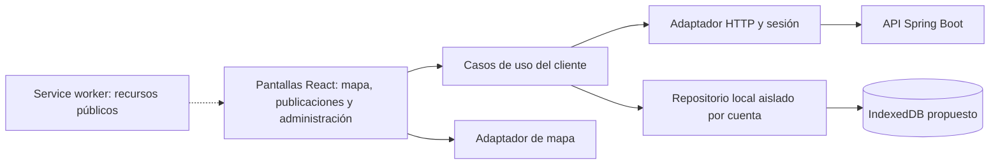

# Arquitectura detallada del frontend

**Estado:** dirección React + TypeScript como PWA adaptable aprobada en Fase 3; recomendaciones detalladas y ajuste de secuencia H1/H5 aprobados por JhanDev. Las herramientas candidatas siguen sujetas a compatibilidad y pruebas de viabilidad; su aprobación no implica instalación ni garantiza proveedores gratuitos. Consulta documental: 18 de noviembre de 2026. El proyecto continúa la evolución del legado Swing: login, registro, mapa, denuncias y novedades son referencias funcionales, no componentes reutilizados literalmente.

## 1. Objetivo y límites

Una sola aplicación web para transportistas y administración, utilizable desde móvil y portátil. Solo usuarios con sesión autorizada consultan datos privados. El sistema representa una demo y no certifica condiciones de una vía. No se solicita interacción al conductor mientras conduce. React, PWA y el navegador por sí solos no garantizan conectividad, seguridad ni entrega de notificaciones.



Las flechas son dependencias propuestas, no integraciones existentes. El repositorio local no sustituye la autorización del servidor; los módulos no acceden directamente al almacenamiento de otro módulo.

## 2. Organización y patrones

| Opción | Ventajas | Costes y límites |
|---|---|---|
| **Por funcionalidad**, con presentación, aplicación y adaptadores donde aporten claridad | Coloca componentes y pruebas de alertas juntos; permite cambiar mapas y almacenamiento; fácil localizar una historia. | Hay que vigilar dependencias entre funcionalidades y no convertir cada archivo en una capa. |
| **Por tipo técnico global**: components, hooks, services, utils | Fácil empezar y familiar para proyectos pequeños. | Una misma historia termina repartida por todo el árbol y crece el acoplamiento global. |
| Arquitectura hexagonal estricta en cada componente | Aislamiento formal y numerosos puntos de sustitución. | Interfaces y archivos innecesarios para una sola persona y formularios simples. |

**Recomendación:** organización por funcionalidad con separación ligera. Usar **adaptador** para identidad, mapa, HTTP y almacenamiento porque son límites sustituibles o difíciles de probar. Una pantalla orquesta acciones; funciones de dominio validan datos y no renderizan ni acceden a la red. Usar estado local de componentes para interacción simple; no imponer una factoría, repositorio o interfaz por cada botón.

Estructura candidata, ajustable tras aprobarla:

```text
frontend/src/
  app/                 composición y navegación
  features/identity/   sesión, acceso y vistas de cuenta
  features/alerts/     creación, listado, filtros y confirmaciones
  features/map/        interfaz y adaptador de mapa
  features/routes/     origen, destino y cercanía
  features/offline/    cola, sincronización y aislamiento por cuenta
  features/admin/      moderación y métricas
  shared/              HTTP, errores y componentes realmente compartidos
```

Las carpetas son una propuesta, no todas existen. Evitar un `shared` que termine absorbiendo reglas del dominio. La autorización real se ejecuta en Spring, no al ocultar una vista.

## 3. Tecnologías: comparación y recomendación

| Decisión | Alternativas y comparación | Propuesta; límites |
|---|---|---|
| Compilación y navegación | **Vite + React Router** genera cliente estático y exige integrar las piezas; **React Router en modo framework** integra enrutamiento y otras capacidades, pero aumenta convenciones y configuración. React recomienda considerar frameworks y reconoce Vite para casos donde un cliente propio encaja. | Vite + React Router en modo apropiado para SPA, sujeto a verificar compatibilidad y necesidad real; sin SSR inicialmente porque el contenido es privado. No es una garantía de menor mantenimiento: habrá que integrar datos, errores y PWA. [React](https://react.dev/learn/build-a-react-app-from-scratch), [React Router](https://reactrouter.com/start/modes). |
| Estado de servidor | **TanStack Query** ofrece caché y revalidación; **fetch + estado React** reduce dependencias, pero deja paginación, duplicación y reintentos a nuestra responsabilidad. | TanStack Query candidato para lecturas y estado remoto; no tratar su caché en memoria como cola offline ni persistir datos privados por defecto. Limpiar y aislar por cuenta. [Documentación](https://tanstack.com/query/latest/docs/framework/react/overview). |
| Estado de interfaz | **React state/context** basta para interacción local y sesión compartida; **Zustand/Redux Toolkit** ofrecen un almacén explícito, a cambio de otra dependencia y convenciones. | Empezar con React state/context; incorporar almacén adicional solo si la complejidad compartida se demuestra. No almacenar contraseñas ni tokens en un store genérico. [React](https://react.dev/learn/managing-state), [Redux](https://redux-toolkit.js.org/introduction/getting-started). |
| Datos offline | **IndexedDB** admite datos estructurados y blobs; **localStorage** es síncrono y no es apropiado para fotos ni operaciones transaccionales de cola. Una biblioteca de IndexedDB reduce complejidad pero añade dependencia. | IndexedDB detrás de un adaptador; decidir API nativa o biblioteca tras prototipo y comparación. No usar caché de peticiones como fuente de verdad de pendientes. [MDN IndexedDB](https://developer.mozilla.org/en-US/docs/Web/API/IndexedDB_API). |
| Service worker | **Workbox/plugin PWA** facilita estrategias y actualizaciones; **API nativa** reduce dependencias pero exige más código y pruebas. | Evaluar plugin compatible con el compilador frente a Workbox directo; mantener recursos públicos separados de datos privados. Instalación y service worker no equivalen a una cola offline funcional. [Workbox](https://developer.chrome.com/docs/workbox), [MDN](https://developer.mozilla.org/en-US/docs/Web/API/Service_Worker_API/Using_Service_Workers). |
| Mapa | **MapLibre GL JS** soporta representación vectorial y estilos compatibles; **Leaflet** ofrece mapa 2D y amplio ecosistema. Ambos requieren tiles, atribución y proveedor autorizados. | Leaflet es candidato inicial para H1 por simplicidad del mapa 2D; evaluar MapLibre si los estilos vectoriales aportan valor. Deben probarse en el dispositivo y con un proveedor autorizado. Ninguna biblioteca ofrece por sí misma rutas ni derecho a descargar mapas. [MapLibre](https://maplibre.org/maplibre-gl-js/docs/), [Leaflet](https://leafletjs.com/). |
| Pruebas | **Vitest + Testing Library + Playwright** cubren lógica, componentes y navegador; **Jest + Testing Library + Cypress** es una alternativa madura con otra integración. | Primera combinación candidata por afinidad con Vite; decidir versiones y soporte antes de instalar. Complementar con prueba en Android real. [Vitest](https://vitest.dev/guide/), [Playwright](https://playwright.dev/docs/intro), [Cypress](https://docs.cypress.io/). |

Versiones exactas, licencias y compatibilidad se fijan al implementar, sin actualizar el equipo de forma implícita. Vite 8 declara Node 20.19+ o 22.12+; la versión local detectada 22.17.1 cumple ese mínimo, pero eso no demuestra compatibilidad con el resto de herramientas ni soporte futuro. [Vite](https://vite.dev/blog/announcing-vite8).

## 4. Offline y seguridad: comportamiento que se debe demostrar

1. Guardar borrador, foto y operación en una transacción local, vinculados a la cuenta. Persistir **antes del primer envío** el `clientReportId`, la clave y el cuerpo exacto; reintentar esa operación sin generar identidades nuevas.
2. Ante fallo de red después de enviar, conservar el borrador y tratar el resultado como incierto; no confirmar publicación por falta de respuesta. Si ya no hay evidencia suficiente por purga, detener el reenvío y solicitar revisión manual. La forma fiable de detectar esa situación sigue abierta.
3. Una sesión previamente validada permite el acceso local solo dentro del plazo acordado de siete días; falta diseñar y demostrar cómo se comprueba ese plazo y se protege ante manipulación del reloj. Sin conexión no se puede conocer una suspensión remota. Aislar cambios de cuenta, conservar pendientes y no prometer protección ante dispositivo comprometido.
4. IndexedDB puede agotar cuota o sufrir desalojo; `navigator.storage.persist()` puede denegarse. Informar el fallo sin declarar que los datos se guardaron; no borrar pendientes para hacer espacio automáticamente. [MDN almacenamiento](https://developer.mozilla.org/en-US/docs/Web/API/Storage_API/Storage_quotas_and_eviction_criteria).
5. Sin red se muestran solamente alertas previamente guardadas, con antigüedad visible. **Mapa offline es una capacidad distinta**: no está demostrada ni autorizada por cualquier proveedor. La política de tiles estándar de OpenStreetMap prohíbe la descarga anticipada para uso offline; se necesita proveedor y licencia que lo permitan o una alternativa de lista. [Política OSM](https://operations.osmfoundation.org/policies/tiles/).
6. No garantizar sincronización ni notificaciones con la app cerrada; Background Sync no está disponible en todos los navegadores. Reintentar al abrir y al recuperar red, sujeto a seguridad de la operación. [MDN](https://developer.mozilla.org/en-US/docs/Web/API/Background_Synchronization_API).

## 5. Estado real y criterios de aceptación

Existe solo `frontend/src/alerts/prepareAlert.ts`: captura un cuerpo/clave en memoria y realiza validaciones preliminares. Sus pruebas se ejecutaron con Node experimental, sin compilación TypeScript, React, almacenamiento, interfaz ni integración. El diseño anterior puede requerir trasladar o ajustar ese archivo después de la aprobación; no se declara listo para envíos.

Antes de conectar el envío: acordar perfil de fechas con Java y contrato OpenAPI, validar representación de categorías y longitud Unicode, verificar autorización/expiración en servidor y probar reinicios y cambio de cuenta. **Ajuste de secuencia aprobado:** H1 debe conservar por cuenta, antes de enviar, al menos la identidad y el cuerpo del intento en línea y detenerse ante resultado incierto; su diseño y prueba quedan pendientes. H5 amplía esto a la cola completa de reportes y fotografías creados offline, sesión local y sincronización. Adelantar esta persistencia mínima no da por terminado H5. Las pruebas de H1 deben demostrar login real, publicación y misma alerta en mapa/lista. Ninguno de esos hitos está terminado.
