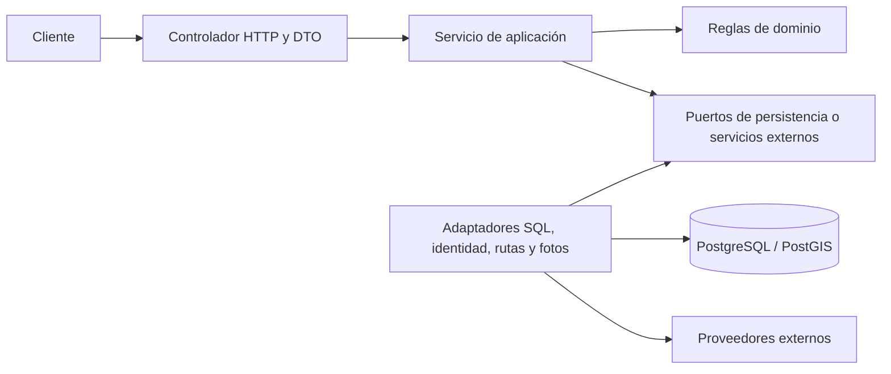

# Arquitectura detallada del backend

**Estado:** la dirección Java/Spring Boot, monolito modular y PostgreSQL/PostGIS fue aprobada en Fase 3 con condiciones; las recomendaciones detalladas fueron aprobadas por JhanDev. Las opciones explícitamente candidatas, versiones y proveedores siguen sujetas a validación de viabilidad y compatibilidad. Consulta documental: 18 de noviembre de 2026. Se conserva la trazabilidad con `Usuario`, `Denuncia`, `Evento`, `Lugar_Denuncia` y `Tramo` del legado; la BD Oracle perdida no se puede migrar como datos existentes.

## 1. Forma del sistema

**Recomendación:** un proceso Spring Boot y una base PostgreSQL/PostGIS, organizado por capacidades de negocio, con capas internas y puertos/adaptadores en los límites que lo justifiquen. Son conceptos complementarios: **monolito modular** describe el despliegue; **capas** distribuyen responsabilidades; **puertos y adaptadores** evitan que dominio y casos de uso dependan de proveedores o mecanismos de persistencia.

| Alternativa | Ventajas | Costes y adecuación |
|---|---|---|
| Monolito modular con capas y adaptadores selectivos | Un despliegue y transacciones locales; módulos comprensibles y adaptadores reemplazables; adecuado a un mantenedor. | Los fallos de proceso afectan al conjunto; exige vigilar dependencias entre módulos y tamaño del despliegue. |
| Monolito con capas globales | Es fácil de comenzar y de entender. | Al crecer, controladores, servicios y repositorios de diferentes dominios se mezclan; no hay aislamiento automático. |
| Microservicios | Despliegue y escalado independientes cuando existen cargas/equipos que lo necesitan. | Más servicios, red, fallos distribuidos, consistencia, observabilidad y cuotas; no existe una necesidad demostrada. |
| Hexagonal estricta para cada clase | Fronteras explícitas y sustitución formal. | Muchas interfaces y capas vacías sin beneficio proporcional en un proyecto de una persona. |

Spring Modulith permite verificar estructura y dependencias de módulos, pero no es imprescindible para tener un monolito modular; compararlo con convenciones y pruebas de arquitectura cuando el número de módulos lo justifique. [Documentación](https://docs.spring.io/spring-modulith/reference/fundamentals.html).



Las flechas representan dependencias conceptuales. Autenticación y autorización se aplican en la frontera y en los casos de uso según corresponda; no basta con ocultar controles en React.

## 2. Organización propuesta

```text
backend/src/main/java/com/jhandev/transpormap/
  identity/       identidad, cuenta, perfil y autorización de dominio
  alert/          alerta, reglas temporales y casos de uso
  community/      confirmaciones cuando se implementen
  geography/      puntos, consulta espacial y rutas cuando se necesiten
  media/          foto y almacenamiento privado
  moderation/     reportes de abuso y auditoría
  notification/   avisos y puesta al día
  shared/         errores y utilidades realmente compartidas
```

Dentro de un módulo que lo necesite: `domain/` (reglas y valores), `application/` (casos de uso y transacciones), `api/` (HTTP/DTO), `infrastructure/` (SQL y adaptadores). Crear subcarpetas cuando existan responsabilidades reales; no mover código existente solo por hacer coincidir el árbol. Dependencias: HTTP → aplicación → dominio; infraestructura implementa puertos necesarios. Cada módulo expone operaciones explícitas, sin acceder libremente a tablas o clases internas de otro.

## 3. Patrones aplicados con propósito

| Patrón o práctica | Problema que resuelve | Aplicación concreta / límite |
|---|---|---|
| Controlador fino y DTO | Separar formato HTTP del negocio. | Validar entrada y mapear errores; no poner SQL o reglas de vigencia en el controlador. DTO no equivale a entidad de BD. |
| Servicio de aplicación | Coordinar una acción del usuario y su transacción. | Publicar alerta: comprobar cuenta, reglas e idempotencia y persistir resultado. No llamar proveedor externo lento manteniendo abierta una transacción. |
| Dominio y objetos de valor | Reglas verificables sin navegador o BD. | Coordenada válida, categoría, hora observada y vigencia; reloj inyectable en reglas dependientes del tiempo. Evitar abstracciones que solo envuelvan un dato sin regla. |
| Repository / puerto y adaptador | Aislar persistencia o proveedor cambiante. | Puerto para guardar/buscar alerta y adaptadores SQL, identidad, ruta o foto cuando sean necesarios. No una interfaz por cada clase simple. |
| Inyección por constructor | Declarar dependencias y facilitar pruebas. | Spring compone servicios y adaptadores; no usar localizadores globales. |
| Máquina de estados explícita | Evitar transiciones y resultados ambiguos. | Separar vigencia y visibilidad; distinguir confirmación, cierre, retirada y operación incierta. Definir transiciones y concurrencia al implementar historias correspondientes. |
| Unidad de trabajo / transacción | Evitar registro parcial o duplicado ante carreras. | Crear alerta, operación idempotente y evidencia juntos; mantener restricciones en BD además de validaciones en Java. [Spring transacciones](https://docs.spring.io/spring-framework/reference/data-access/transaction/declarative/annotations.html). |

No se propone introducir CQRS, event sourcing, broker, microservicios ni una factoría genérica sin un requisito medido. Eventos de dominio pueden evaluarse cuando exista un consumidor real y estrategia de reintentos; un evento en memoria no garantiza entrega tras una caída.

## 4. Persistencia, API e identidad

| Decisión | Alternativas y recomendación | Consecuencia / condición |
|---|---|---|
| Acceso a datos | **JDBC/SQL explícito** facilita controlar consultas PostGIS y transacciones, con mapeo manual; **Spring Data JPA** reduce código CRUD, pero añade un modelo ORM y requiere verificar consultas espaciales y relaciones. | Proponer JDBC para el primer flujo y consultas espaciales; JPA sigue siendo válida. No instalar ambos por defecto. Decidir con el propietario y comprobar con PostGIS real. [Spring SQL](https://docs.spring.io/spring-boot/reference/data/sql.html). |
| Migraciones | **Flyway** con SQL versionado y sumas de verificación; **Liquibase** con changelogs y opciones más amplias, a costa de más convenciones. | Proponer Flyway con migraciones SQL y revisar versión/licencia/soporte. Evitar mezclar métodos de inicialización de esquema. [Spring Boot](https://docs.spring.io/spring-boot/how-to/data-initialization.html), [Flyway](https://documentation.red-gate.com/fd/versioned-migrations-273973333.html). |
| Espacial | **PostGIS** brinda tipos y operadores geográficos; **MySQL espacial** es alternativa con otro conjunto de capacidades. | Dirección PostGIS aprobada condicionalmente. Para proximidad usar tipo/operador e índice apropiados; `ST_DWithin` con geography usa metros. Probar coordenadas WGS84 y orden longitud/latitud contra PostGIS real. [PostGIS](https://postgis.net/docs/ST_DWithin.html). |
| Identidad | **Proveedor externo + Resource Server** reduce gestión de credenciales; **identidad propia** da control pero exige recuperación, correo, defensa contra abuso y mantenimiento. | Proveedor externo candidato, aún no probado. Spring verifica firma, emisor, vencimiento, audiencia y cuenta/rol locales con configuración explícita. Sesión válida no sustituye autorización de dominio. [Spring Security](https://docs.spring.io/spring-security/reference/servlet/oauth2/resource-server/jwt.html). |
| API | **REST/JSON con OpenAPI** es simple para cliente y pruebas; **GraphQL** ofrece consultas flexibles pero añade complejidad de autorización y caché. | REST versionada `/v1` con errores consistentes; el contrato existente es preliminar y debe probarse frente a implementación. |
| Calidad arquitectónica | **Convenciones y pruebas puntuales** tienen bajo coste inicial; **Spring Modulith/ArchUnit** automatizan restricciones con dependencias adicionales. | Empezar con límites explícitos y revisión; añadir verificación automatizada al existir suficientes módulos y validar compatibilidad. [Spring Modulith](https://docs.spring.io/spring-modulith/reference/verification.html). |

## 5. Publicación e idempotencia

1. El cliente envía operación identificada por autor autenticado, `clientReportId` y `Idempotency-Key`, con cuerpo y hora observada sin cambio silencioso.
2. El servidor valida token, cuenta, contenido, hora futura y reglas; obtiene hora recibida con reloj controlable. La vigencia depende de la observación. La misma fecha con otra zona debe representar el mismo instante; acordar el perfil temporal exacto y sus límites con frontend y OpenAPI.
3. La BD debe hacer atómicas la alerta, la identidad de la operación y la evidencia necesaria para reintentos; una restricción única y una transacción protegen contra carreras. Mientras haya evidencia y autorización, misma operación/contenido devuelve el mismo resultado; contenido distinto produce conflicto. Probar con peticiones concurrentes y respuesta perdida.
4. Si ya no hay evidencia por retención/eliminación y no es posible conocer el resultado, no generar duplicados silenciosamente: conservar borrador/foto y solicitar revisión manual. **La detección fiable del caso sigue pendiente**; una restricción única no resuelve deduplicación perpetua ni evita resurrección tras una purga. [PostgreSQL INSERT](https://www.postgresql.org/docs/current/sql-insert.html).
5. Una fotografía se procesa por separado; revalidar autorización y estado al asociarla y servirla para que un envío tardío no restaure contenido retirado. No se presupone que una URL firmada permita revocación inmediata.

## 6. Pruebas y límites actuales

- Unitarias: reglas de dominio, límites temporales con reloj fijo y transiciones; una zona distinta para el mismo instante debe conservar el significado.
- Integración: migraciones, unicidad y consultas espaciales en PostgreSQL/PostGIS real mediante Testcontainers; H2 no sustituye funciones y tipos PostGIS. El runtime de contenedores aún no está disponible. [Testcontainers](https://java.testcontainers.org/supported_docker_environment/).
- HTTP y seguridad: contrato, JWT válido/inválido, cuenta suspendida, acceso anónimo, errores, carreras y petición directa sin permisos; E2E autenticado cuando exista el flujo completo.
- Operación: arranque, logs sin secretos ni trayectorias, salud, métricas y recuperación de BD **y** archivos; una respuesta de salud no demuestra disponibilidad de dependencias.

Hoy existe un esqueleto Spring Boot 4.1.2 con Java 25 y Maven Wrapper, `GET /v1/health`, denegación por defecto, reglas temporales, coordenadas y mapeo de categorías. **No existen aún** API de alertas, repositorios, migraciones, PostGIS, JWT real ni proveedor integrado. Las versiones fijadas en código no acreditan compatibilidad del hosting. Se fijó y verificó el checksum del wrapper con cachés nuevas, sin verificar firma PGP. El mapeo del enum aún debe conectarse a HTTP y probarse contra el contrato.
